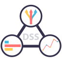
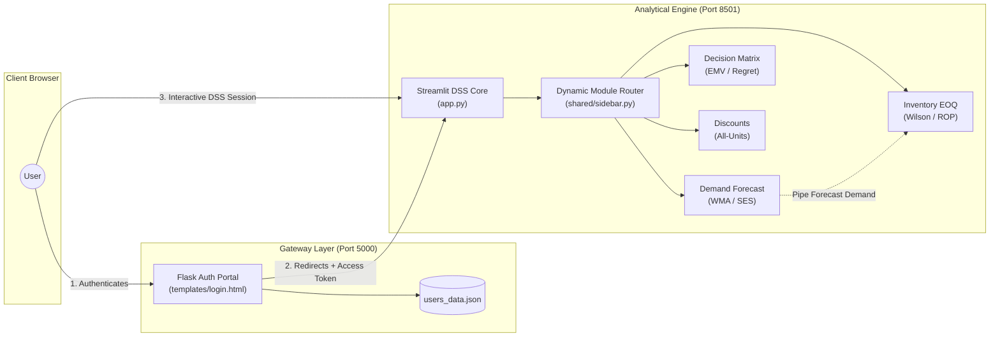

<p align="center">
  
</p>

<h1 align="center">DecisionCore DSS</h1>

<p align="center">
  <strong>Enterprise Decision Support System for Quantitative Modeling, Inventory Optimization & Risk Simulation</strong>
</p>

<p align="center">
  
  
  
  
  
</p>

---

## 📌 Project Overview & Purpose

**DecisionCore DSS** is a full-featured Decision Support System engineered to assist corporate executives, financial analysts, and supply-chain strategists in evaluating complex operational decisions under market uncertainty and volatility.

Bridging classical **Operations Research** with modern **interactive computing**, DecisionCore DSS eliminates guesswork by combining predictive demand modeling, classical inventory theory, multi-criteria decision matrices, and high-iteration **Monte Carlo stochastic simulations** into a unified executive cockpit.

---

## ⚡ What It Does (Core Modules)

DecisionCore DSS delivers four integrated quantitative pillars:

| Module | Mathematical Foundation | Core Capabilities |
| :--- | :--- | :--- |
| **📈 Demand Forecasting** | WMA, Simple Exponential Smoothing (SES), Monte Carlo | Historical trend modeling, auto-benchmarking using error metrics (**MAD**, **MSE**, **MAPE**), and probabilistic demand projection. |
| **⚖️ Decision Analysis** | Classical Decision Theory (Risk & Uncertainty) | Payoff matrix evaluation across 8 standard criteria: **Maximax**, **Minimax (Wald)**, **Hurwicz (α-realism)**, **Laplace**, **EMV (VME)**, **Minimax Regret (POE)**, **EVwPI (VECIP)**, and **EVPI (VEIP)**, backed by payoff distributions. |
| **📦 Inventory Optimization** | Wilson's EOQ (CLE) & Reorder Point (ROP) | Balances annual ordering ($C_o$) vs. holding costs ($C_h$), identifies optimal batch sizes ($Q^*$), calculates safety stock and ROP, with direct data piping from the Forecasting module. |
| **🏷️ Quantity Discounts** | All-Units Discount Scale Model | Iterates across supplier price breaks, determines feasibility intervals for lot sizes, computes total acquisition cost curves, and runs stochastic sensitivity checks. |

---

## 🏛️ System Architecture

DecisionCore DSS uses a **Dual-Process Hybrid Architecture**, decoupling entry authentication from reactive computational dashboards:



### Architectural Highlights
- **Separation of Concerns:** A dedicated Flask portal isolates session handling and credentials, protecting the analytical workbench.
- **Reactive State Pipeline:** Cross-module state sharing allows calculated annual demand from forecasting to directly drive EOQ and ROP computations without re-entry.
- **Orchestrated Runtime:** A single entrypoint (`run_demo.py`) monitors both micro-servers concurrently with automatic signal trapping (`SIGINT`) and clean teardowns.

---

## 💻 Tech Stack

- **Runtime & Language:** Python 3.13+
- **Application Framework:** Streamlit (Reactive Analytics Engine), Flask (Authentication Gateway)
- **Mathematical & Matrix Computation:** NumPy, Pandas
- **Data Visualization:** Matplotlib, Plotly (Dynamic distributions & risk sensitivity charts)
- **Frontend & Styling:** Custom CSS3 & Jinja2 templates for the login portal

---

## 📂 Repository Structure

```text
DecisionCore-DSS/
├── app.py                     # Streamlit main dashboard & session sync
├── portal.py                  # Flask authentication gateway
├── run_demo.py                # Dual-process orchestrator
├── auth/                      # Credential authentication logic
├── data/                      # User configuration & persistent store
├── assets/                    # Project branding & visual assets
├── shared/                    # Shared components (sidebar, navigation)
├── static/ & templates/       # Auth portal UI & custom CSS styles
└── features/
    ├── forecast/              # Demand forecasting & Monte Carlo
    ├── desicion_analysis/     # Payoff matrices & 8 decision criteria
    ├── inventory/             # Wilson EOQ & Reorder Point models
    └── discount_analysis/     # Price break & quantity discount solver
```

---

## 🚀 Quickstart

### 1. Installation
Clone the repository and install the dependencies:
```bash
git clone https://github.com/DereckGC/DecisionCore-DSS.git
cd DecisionCore-DSS
pip install -r requirements.txt
```

### 2. Launch the Platform
Start both the authentication gateway and the analytics dashboard with a single command:
```bash
python run_demo.py
```

### 3. Access & Demo Credentials
Open your browser at **`http://localhost:5000`** and log in with any of the demo accounts:

| Role | Email | Password |
| :--- | :--- | :--- |
| **Administrator** | `admin@decisioncore.com` | `admin123` |
| **Executive Analyst** | `analista@decisioncore.com` | `demo123` |

---
